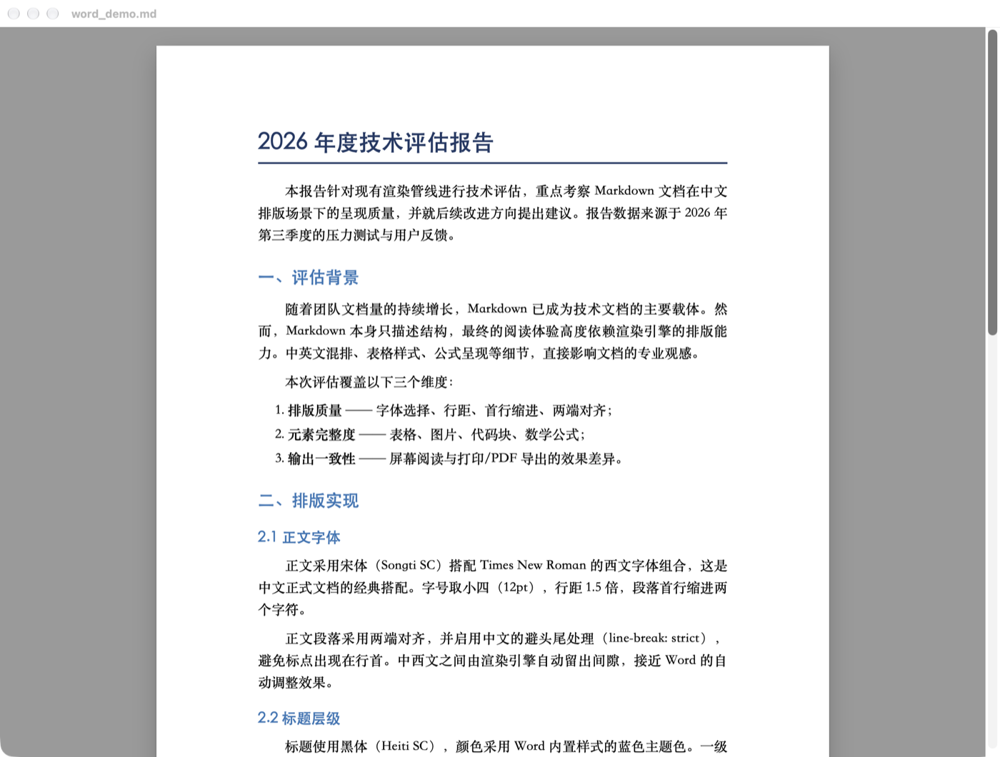
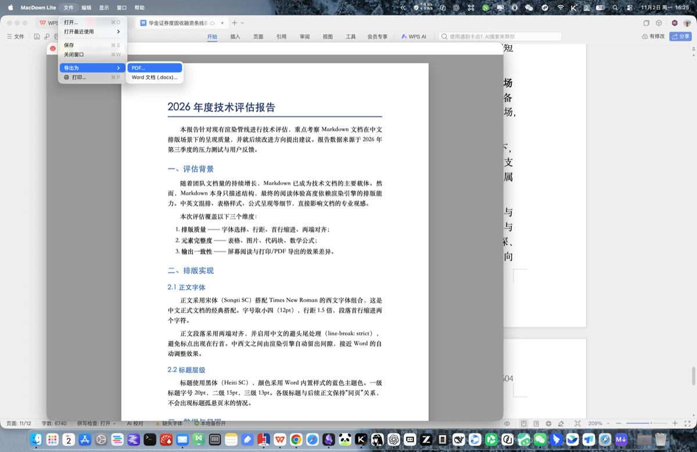
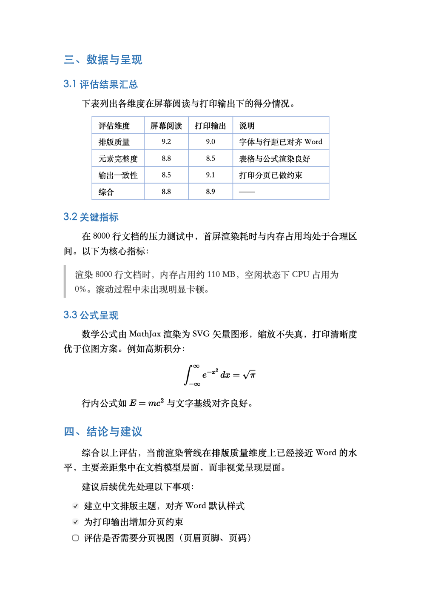

# MacDown Lite

**Apple 芯片原生的 Markdown 阅读器 —— 纯阅读，渲染讲究，可导出 PDF / Word。**

MacDown 是很多人喜欢的 Markdown 编辑器，但它停留在 x86_64，在新 Mac 上只能靠 Rosetta 跑。
本项目把它的**渲染内核与主题**取出来，重新做了一个只读的阅读器外壳：打开就是排版好的成品，
不需要编辑器，也不再经过 Rosetta。



## 特性

**渲染**
- 渲染内核沿用 MacDown 的 [hoedown](https://github.com/hoedown/hoedown)（含 MacDown 的补丁），行为对齐
- 7 套主题，含一套仿 Word 的中文排版主题
- 代码块语法高亮（Prism，67 种语言）
- 数学公式（MathJax 3，**字体内嵌、完全离线**）
- 表格、任务列表、脚注、引用、上标、高亮、SmartyPants 智能标点

**阅读**
- 外部改动自动刷新（在别的编辑器里保存，这边立刻更新）
- 页内查找 `⌘F`：逐键即搜、`n / m` 计数、`⌘G` / `⇧⌘G` 跳转、环绕、区分大小写
- 多窗口、拖拽打开、最近文件、缩放、打印

**导出**
- **PDF** —— A4 分页，页边距与屏幕纸张一致，输出真正的文字 PDF（可选中、可搜索）
- **Word (.docx)** —— 真正的 OOXML 文件，Word / WPS / Pages 可直接打开编辑



## 「Word 文档」主题

对齐 Word 的中文默认排版：A4 白纸 + 灰底，宋体 + Times New Roman 正文，小四 12pt，
1.5 倍行距，**首行缩进 2 字符**，两端对齐并处理中文避头尾，标题用 Word 内置的蓝色主题色，
表格用「网格型（浅色）」。

> 纸张外观只在**屏幕**上生效（`@media screen`）；打印与导出交给 `@page`，
> 所以 PDF 里不会带上灰底和阴影。



## 系统要求

- macOS 13 或更高
- Apple 芯片（arm64）。**只构建 arm64，不含 x86_64**
- 构建需要 Xcode Command Line Tools（`clang` + `swiftc`）——**不需要完整 Xcode**

## 构建

```bash
git clone <this repo> && cd macdown-lite
./build.sh                    # 产出 build/MacDown Lite.app
./tests/run_regression.sh     # 回归测试
```

仓库自带全部依赖（hoedown 源码、Prism bundle、MathJax、主题），**构建过程不需要联网**。

安装：

```bash
cp -R "build/MacDown Lite.app" /Applications/
```

首次打开若被系统拦下，去「系统设置 → 隐私与安全性」点「仍要打开」——本 app 是本地
ad-hoc 签名，未做 Apple 公证。

## 用法

| 操作 | 快捷键 |
| --- | --- |
| 打开文件 | `⌘O` |
| 查找 | `⌘F` |
| 查找下一个 / 上一个 | `⌘G` / `⇧⌘G` |
| 重新载入 | `⌘R` |
| 放大 / 缩小 / 实际大小 | `⌘+` / `⌘-` / `⌘0` |
| 打印 | `⌘P` |
| 导出 PDF / Word | 文件 → 导出为 |
| 全屏 | `⌃⌘F` |
| 编辑模式（默认关闭） | `⌘E` |

设成 `.md` 默认打开方式：选中任意 `.md` → 右键 → 显示简介 → 打开方式选 MacDown Lite → 全部更改。

## 架构

```
Markdown ──MathPreprocessor──▶ hoedown(C) ──▶ HTML ──▶ WKWebView
                  │                                   │
                  └─ 抽取 TeX，渲染后还原为 MathJax 定界符  │
                                                      ├─ mdview:// 自定义 scheme（本地图片、资源）
                                                      ├─ search.js（CSS Custom Highlight 查找）
                                                      └─ export-model.js ──▶ DocxExporter ──▶ .docx
```

几个值得一提的设计决定：

- **不用 hoedown 自带的数学扩展**：它要求写双反斜杠才认 `\(...\)`，还会把 `$5` 当公式。
  改为自写 `MathPreprocessor` 在渲染前抽取、渲染后还原，四种定界符都能用且不误判价格。
- **导出 Word 不复用 HTML 解析**：而是在**已渲染的页面**里把 DOM 抽成扁平的文档模型
  （`export-model.js`），这样图片尺寸、公式 SVG 都是现成的。公式在 Swift 侧离屏栅格化成
  3 倍分辨率 PNG 后嵌入。
- **`mdview://` 自定义 scheme**：让相对路径图片、绝对路径、`../` 上跳都能正确解析，
  同时不必把整个磁盘的读权限交给 WebView。
- **docx 的 ZIP 自己写**（`ZipWriter`，stored 模式 + CRC-32），避免引入压缩依赖。

## 测试

`tests/run_regression.sh` 共 **4 组 74 项**：

| 组 | 内容 | 项数 |
| --- | --- | --- |
| 1 | `MathPreprocessor` 单元测试（含 `$5`、代码块保护等边界） | 19 |
| 2 | 页面内查找 + MathJax 端到端（离屏 WKWebView） | 20 |
| 3 | 打印媒体语义（纸张模型仅在屏幕生效） | 9 |
| 4 | 导出：docx 包结构 / XML 良构 / 列表编号闭合 / PDF 页数与文字层 | 26 |

## 已知限制

- **不是编辑器**。编辑模式（`⌘E`）只是个方便的纯文本面板，默认关闭。
- **Mermaid / Graphviz** 未支持。
- **无页眉页脚 / 页码 / 题注 / 交叉引用** —— 这些依赖 Word 的分页文档模型，不是渲染层能补的。
- **导出的 Word 里公式是图片**，不是可编辑的 Word 公式对象（TeX → OMML 需要整套转换器）。
- 脚注导出为文末段落；目录（`[TOC]`）导出为静态列表，Word 里不能自动更新页码。

## 许可

本项目自有代码：MIT（见 `LICENSE`）。
复用的第三方组件（MacDown 的主题与补丁、hoedown、Prism、MathJax）见 `THIRD-PARTY.md`，
许可原文收录在 `licenses/`。

本项目与 MacDown 官方无关，只是复用其渲染内核与主题的独立作品。
